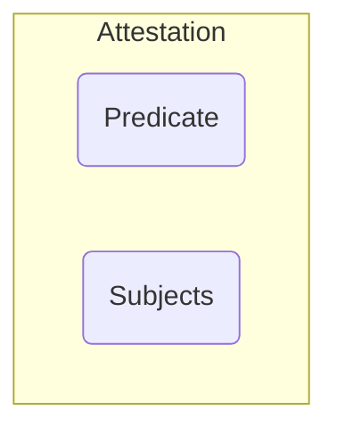

# The AMPEL Attestation Framework

AMPEL natively works with the in-toto attestation format. However, the policy
engine has its own attestation abstraction built on top of the in-toto format
to support more signing formats and wrappers.

## How AMPEL Abstracts Attestations

The in-toto attestation format breaks an attestation into two main parts: the
subjects and the predicate. The subjects are the pieces of software that the
attestation refers to, while the predicate describes what is being claimed or
asserted about those subjects.



Usually, subjects are software artifacts, but anything that can be represented
as a hash can be a subject including git commits or manifests. On the other hand,
the attestation predicate will usually be a known format but can be any valid JSON.

### Wrappers

Attested data may come wrapped in an envelope. Envelopes can be used to sign 
attested data, bundle more thatn one attestation and other reasons.

#### Signed Envelopes

Attestations will most often be wrapped in a signed envelope. Natively, AMPEL
supports attestations wrapped in DSSE (dead-simple signing envelope) and sigstore
bundles.

##### DSSE Envelopes

The simplest attestation envelope is DSSE. This is a thin layer around an in-toto
statement adding a signature and information about the key used to sign it.

##### Sigstore Bundles

Sigstore bundles wrap the attested data not just with their certificate and
signature, but also all the verification material required to verify the signature.

#### The "Bare" Envelope

To keep the model consistent, when ingesting non-signed data, AMPEL synthesizes
a _bare_ envelope. When parsing unsigned attestations ampel returns them with a
"bare" envelope to ensure all methods still work on them.

> [!IMPORTANT]
> A key notion to understand is that when performing an evaluation, AMPEL
> _peels off_ the attestation and only exposes the predicate to the evaluation
> engine. AMPEL processes and exposes to the runtime some of the attestation
> attributes such as the subject and the signer identities but only the data
> of the predicate gets loaded raw.

### Attestation Contents

#### Subjects

In-toto attestations can have more than one "subject" - a hash of whatever the
attestation is referring to. Note that while it is possible to write a
ResourceDescriptor without digests (hashes), AMPEL can only evaluate on hashes.

Evaluations can only be performed on one of the subjects at a time. Ampel can
take a hash or a file as subject in its command line but when specifying a file,
all hashes in the attestation subject must match the file.

#### Predicates

Predicates are the claims being done about the subjects. Any valid json can be
a predicate but most often attestations will contain data conforming to one
of the numerous standard supply chain security formats.

## Reading Attestations

Before executing a policy's tenets, AMPEL will read and select the attestations
required by the policy as specified in its predicate spec. From all the available
attestations, only those that meet the type specification and subject will be exposed
to the runtime.

The attestation format is defined by its _predicate type_ which is a versioned
URL. AMPEL policies specify what kind of data they need by enumerating one or more
predicate types.

Predicate specs may select a specific predicate type version or specify the type
without a version to force AMPEL to select all attestations of that type,
regardless of version.

### Collectors

Attestations can be read from different sources which are accessed by _collectors_.
The AMPEL attestation framework comes with some built-in collectors that can
read attestations from directories, software releases, OCI registries, etc. 
Collectors are plug-ins and more can be added.

### Queries and Filters

Internally, collectors use attestation _queries_ to select the required attestations
for a policy event. If a collector's backend cannot select attestations based on
their properties (for example when reading plain files), it can use AMPEL's filtering
capabilities in a query to find the data it needs. 

## Signatures and Identities

As mentioned, attestations can be wrapped in signed envelopes. But it is important
to differentiate between the signature providing authenticity and inegrity guarantees
and the _signing identity_.

When loading an attestation, AMPEL verifies its signature automatically and
admits it as evidence only when the signature verified against the material it
holds: the sigstore trust roots for bundles, the configured public keys
(`--key` and any keys pinned in the policy identities) for DSSE envelopes. This
signature gate does not depend on the policy or on how the attestation was
signed. A bare statement carries no signature, and an envelope signed with a
key the verifier does not hold cannot be checked; both are simply _unverified_
and are dropped from the evidence set. When every attestation supplied for a
subject is unverified, the policy fails with an explicit "no verified
attestations" error rather than reporting the evidence as missing.

There is one deliberate exception. The `ampel verify` CLI admits unverified
attestations passed with `--attestation` / `-a`, on the grounds that handing a
file to the verifier is an explicit choice. Attestations found by collectors are
never admitted unverified, and the exception ends as soon as the policy (or
`--signer`) pins signer identities: from then on unverified attestations are
skipped and only signed evidence from an accepted identity counts. Admitted
unverified attestations reach policies with `verification.verified` set to
false so a policy can still tell them apart. Library callers get the same
behavior through the `AdmitUnverified` verification option.

These rules cover every attestation a policy reads, including the ones a
[chain](03-ampel-policy-guide.md#who-signs-a-hop) follows to reach its subject:
a hop's attestation must pass the same signature and identity gates, and is
admitted unverified only under the exception above.

But when it comes to the signing identity, AMPEL does not do any assumptions. It is
up to the policy to define who can sign attestations. _Who_ in this context refers
to a key or sigstore identity, or a mix of both. Identities pinned in a policy
always win over `--signer`: a signed policy cannot be loosened from the command
line, and an operator who needs more signers extends the policy instead.

## Producing Result Attestations

When AMPEL evaluates a policy, the results can themselves be captured as
in-toto attestations. This makes them reusable as input evidence for
downstream policies — verifying once and asserting many times.

### Output Paths

Result attestations can be produced through two channels:

- `--attest-results` writes the attestation to a file. The path is
  controlled with `--results-path` (defaults to `results.intoto.json`)
  and the format with `--attest-format`.
- `--format=attestation|vsa|svr` writes the attestation to standard
  output in place of the default human-friendly view.

The two channels are independent and can be combined: a single run can
write a VSA to stdout and an ampel-format attestation to a file.

### Result Attestation Formats

AMPEL supports three result-attestation formats:

| Format | Predicate Type | Description |
|---|---|---|
| `ampel` | `https://carabiner.dev/ampel/resultset/v0` | The full ampel ResultSet — every assertion, control and identity. Designed to be re-ingested as evidence for further policies. |
| `vsa` | `https://slsa.dev/verification_summary/v1` | A SLSA Verification Summary Attestation. Maps the evaluation status to a VerificationResult and lifts SLSA controls to VerifiedLevels. |
| `svr` | `https://in-toto.io/attestation/svr/v0.1` | A Simple Verification Result. Compact pass/fail summary with property labels. |

The default file format is `ampel`; stdout defaults to the `tty`
human-friendly view.

### Signing Result Attestations

By default, result attestations are written as raw in-toto Statements.
Pass `--sign` to wrap the produced attestation in a signed envelope.
The same `--sign` flag covers both output paths above.

The signing backend is selected with `--signing-backend` and is
auto-detected from the supplied flags when the explicit value is left
empty:

- `key` — auto-selected when `--signing-key` is set. Produces a DSSE
  envelope signed with the supplied private keys (PEM PKCS#8/PKCS#1/SEC1
  or OpenPGP, repeatable). Encrypted keys can be unlocked via the env
  var named in `--signing-key-passphrase-env`.
- `spiffe` — auto-selected when `--spiffe-socket` is set. Produces a
  sigstore Bundle whose certificate chain comes from a SPIFFE-issued
  SVID fetched from the Workload API.
- `sigstore` — fallback when neither of the above is set. Produces a
  sigstore Bundle via the public-good instance with an interactive
  OIDC flow; for non-interactive CI use `--sigstore-oidc-token-file`.

The full set of backend-specific flags appears under **Signing Flags**
in `ampel verify --help`.

### Output Shape

The wire format of the produced attestation depends on the signer:

- **Unsigned** (no `--sign`) — a bare in-toto Statement carrying the
  selected predicate.
- **Key backend** (`--sign` + `--signing-key`) — a DSSE envelope
  whose payload is the base64-encoded Statement.
- **Sigstore / SPIFFE backend** (`--sign` with sigstore or SPIFFE) — a
  sigstore Bundle: certificate chain, DSSE envelope, and (when
  `--signing-timestamp` is on, the default) an RFC 3161 timestamp.

### Examples

```shell
# Write an ampel-format result attestation to a file (unsigned)
ampel verify ... --attest-results --results-path=results.intoto.json

# Emit a VSA to stdout
ampel verify ... --format=vsa

# Sign with a local key, file output (DSSE envelope)
ampel verify ... \
  --attest-results --results-path=results.intoto.json \
  --sign --signing-key=signing.key

# Sign with sigstore, VSA bundle to stdout
ampel verify ... --format=vsa --sign

# Sign with SPIFFE Workload API, SVR bundle to file
ampel verify ... \
  --attest-results --attest-format=svr --results-path=svr.bundle.json \
  --sign --spiffe-socket=unix:///run/spire/sockets/api.sock \
  --spiffe-trust-domain=prod.example.org
```

## Attestation Tooling

The AMPEL ecosystem includes tools to work with attested data. 

### bnd

Bnd (pronounced "bind") is a tool that tries to be the Swiss Army knife to
work with attestations. Bnd can sign, verify and explore the contents of
attestations, as well a attest any file committed to a git repository.

bnd can be downloaded from https://github.com/carabiner-dev/bnd
